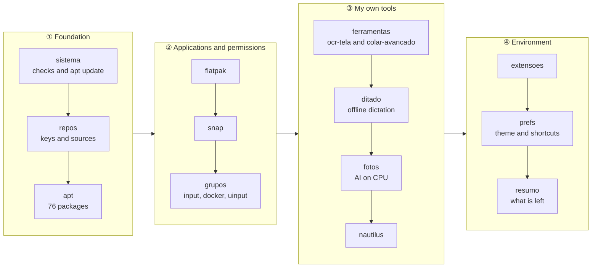

<div align="center">

# 🧰 nova-maquina

**One command between a freshly installed Ubuntu and a ready workstation.**

Thirteen selectable stages, a simulation mode and no leaps of faith: every
stage checks before acting, says what it did, and notes at the end what still
depends on you.

[](LICENSE)
[](#requirements)
[](instalar.sh)
[](#what-the-simulation-shows)

[Português](README.md) · **English**

`76 packages` · `18 Flatpaks` · `2 Snaps` · `3 GNOME extensions` · `4 tools of my own`

</div>

---

> The script, its stages and its flags are in Portuguese, since it rebuilds a
> Brazilian desktop. This page documents them as they are, so the command you
> read here is the command you type.

## The problem

Reinstalling the system is the easy part, and it takes an afternoon. What costs
is the week that follows: the shortcut you no longer remember creating, the
package that only shows up when it is missing, the extension that needed one
odd step, the repository key nobody wrote down. A workstation's setup lives
nowhere — it lives in the memory of whoever built it, and that memory expires.

This repository is that setup, written down. It was not drafted from memory: it
came out of an inventory of the running machine — `apt-mark showmanual` crossed
with what shipped in the base install, plus Flatpak, Snap, extensions, services
and `dconf`.

## In thirty seconds

```bash
git clone https://github.com/augustotecnos/nova-maquina.git
cd nova-maquina
./instalar.sh --simular      # prints everything it would do, touching nothing
./instalar.sh                # does it
```

No network on the new machine? Copy the whole folder on a USB stick — the
script does not need to live in a git repository. And it is safe to run again:
every stage checks before acting.

## The path



## What the simulation shows

`--simular` prints each command instead of running it. Real output from this
machine, with the home path shortened:

```console
$ ./instalar.sh --simular --so grupos,ditado

╺━ Grupos e permissões de entrada ━╸
  · já está no grupo input
  · já está no grupo docker
==> Regra do udev para o /dev/uinput
     $ sudo install -Dm644 ~/Projetos/nova-maquina/arquivos/udev/80-uinput.rules /etc/udev/rules.d/80-uinput.rules
     $ sudo udevadm control --reload-rules
==> Serviço do ydotool (digitação de reserva, sessão local)
     $ systemctl --user enable --now ydotool.service 2>/dev/null || true

╺━ Ditado por voz (Super+H) ━╸
  · ambiente Python já existe
==> instalando o daemon, o comando e o serviço
     $ install -Dm644 ~/…/arquivos/ditado/server.py ~/.local/share/ditado/server.py
     $ systemctl --user daemon-reload
```

Three signals, always the same: `==>` is what is about to be done, `·` is what
was already in place, `$` is the exact command — in a real run, it runs.

## Stages

| # | Stage | What it does |
|---|---|---|
| 1 | `sistema` | checks Ubuntu/GNOME/Wayland and refreshes the apt indexes |
| 2 | `repos` | Chrome, Edge, VS Code, Docker, the Ulauncher and Grub Customizer PPAs, Flathub, Tailscale |
| 3 | `apt` | the 76 packages, in seven commented groups |
| 4 | `flatpak` | 15 applications from Flathub, plus 3 games |
| 5 | `snap` | onlyoffice-desktopeditors, zotero-snap |
| 6 | `grupos` | the `input`, `docker`, `kvm` and `libvirt` groups, plus the `uinput` rule |
| 7 | `ferramentas` | clones and installs [ocr-tela](https://github.com/augustotecnos/ocr-tela) and [colar-avancado](https://github.com/augustotecnos/colar-avancado), plus the `claude` CLI |
| 8 | `ditado` | offline voice dictation on `Super+H` (faster-whisper on CPU) |
| 9 | `fotos` | background removal with `rembg`; object removal with IOPaint (optional) |
| 10 | `nautilus` | "Copy path", "Remove background" and "Erase object" in the file manager menu |
| 11 | `extensoes` | GSConnect, Draw on GNOME and GJS OSK |
| 12 | `prefs` | dark theme, shortcuts, and freeing up `Super+H` |
| 13 | `resumo` | the list of what still depends on you |

```bash
./instalar.sh --so ditado,fotos     # only these stages
./instalar.sh --sem jogos,snap      # every stage except these
./instalar.sh --listar              # what exists
```

<details>
<summary><b>See the 76 apt packages, by group</b></summary>

**Base** — command line and system utilities (25)

`curl` · `wget` · `git` · `vim` · `nano` · `htop` · `ncdu` · `tmux` · `dos2unix` · `fastfetch` · `build-essential` · `make` · `cmake` · `openssh-server` · `openssh-client` · `synaptic` · `gdebi` · `baobab` · `gparted` · `timeshift` · `dconf-editor` · `gnome-tweaks` · `gnome-shell-extensions` · `flatpak` · `gnome-software-plugin-flatpak`

**Brazilian Portuguese** — spell checker, dictionaries and translated help (6)

`hunspell-pt-br` · `wbrazilian` · `wportuguese` · `gnome-user-docs-pt` · `libreoffice-l10n-pt-br` · `libreoffice-help-pt-br`

**Applications** — the everyday set (14)

`libreoffice` · `thunderbird` · `calibre` · `pdfarranger` · `gthumb` · `vlc` · `mpv` · `haruna` · `torbrowser-launcher` · `ulauncher` · `grub-customizer` · `google-chrome-stable` · `microsoft-edge-stable` · `code`

**Media** — image, video and audio (8)

`gimp` · `inkscape` · `krita` · `blender` · `kdenlive` · `audacity` · `obs-studio` · `ffmpeg`

**Development** — languages, database and containers (17)

`python3-pip` · `python3-venv` · `python3-gi` · `python3-pil` · `nodejs` · `npm` · `golang-go` · `ruby` · `default-jre` · `openjdk-17-jdk` · `sqlite3` · `postgresql` · `postgresql-client` · `docker-ce` · `docker-ce-cli` · `containerd.io` · `docker-compose-plugin`

**Support for my own tools** — what the projects' own installers do not cover (3)

`pulseaudio-utils` · `ydotool` · `python3-nautilus`

**Virtualisation** — virtual machines (3)

`qemu-system-x86` · `virt-manager` · `libvirt-daemon-system`

</details>

<details>
<summary><b>See the 18 Flatpak applications and the 2 Snaps</b></summary>

**Flatpak** (15)

`com.brave.Browser` · `com.discordapp.Discord` · `com.github.dail8859.NotepadNext` · `com.github.vkohaupt.vokoscreenNG` · `com.spotify.Client` · `io.github.diegoivan.pdf_metadata_editor` · `io.github.giantpinkrobots.bootqt` · `me.fouquet.Stencil` · `nl.hjdskes.gcolor3` · `org.deskflow.deskflow` · `org.flatpak.Builder` · `org.gnome.design.Palette` · `org.kde.krename` · `org.localsend.localsend_app` · `org.telegram.desktop`

**Games** (3) — skip with `--sem-jogos`

`com.valvesoftware.Steam` · `net.lutris.Lutris` · `com.heroicgameslauncher.hgl`

**Snap** (2)

`onlyoffice-desktopeditors` · `zotero-snap`

</details>

## Options

| Option | Effect |
|---|---|
| `-n`, `--simular` | prints each command instead of running it |
| `-l`, `--listar` | lists the stages |
| `--so a,b` / `--sem a,b` | picks or skips stages |
| `--sem-jogos` | does not install Steam, Lutris and Heroic |
| `--sem-opcionais` | does not install Tailscale |
| `--com-iopaint` | installs IOPaint (1.6 GB, isolated Python 3.11) |
| `--com-experimentos` | installs what sits in `apt-experimentos.txt` |

The `sudo` password is only asked for when a chosen stage actually touches the
system — `--so prefs`, for instance, runs without asking for anything.

## Requirements

| Item | Detail |
|---|---|
| System | Ubuntu 26.04 (`resolute`); other releases get a warning and carry on |
| Desktop | GNOME on Wayland — the tools of my own assume it |
| Network | required, unless you bring the folder ready |
| Disk | budget 15–25 GB in total — Flatpaks and games are the largest share. Measured here: dictation 905 MB, `rembg` 793 MB, IOPaint +1.6 GB |
| Privilege | `sudo`, and only in the stages that touch the system |

## What it deliberately does not install

`listas/apt-experimentos.txt` keeps what was tried on this machine and left
behind, each with the reason in a comment:

| Package | Why it stayed out |
|---|---|
| `onboard`, `maliit-*`, `matchbox-keyboard` | X11-era virtual keyboards; on Wayland they come up crippled. The **GJS OSK** extension replaced them |
| `flameshot` | cannot register a global shortcut on Wayland |
| `esearch` | dropped in favour of `ocr-tela` |

Install them with `--com-experimentos` if you want to reassess.

## What no script can solve

1. **Logging out and back in.** New groups and GNOME extensions only take
   effect in a new session — on Wayland there is no `Alt+F2` → `r`.
2. **Pairing the phone in GSConnect** and then turning on the two clipboard
   keys, which ship disabled (the command is printed by the `resumo` stage).
3. **Accepting once** the "Remote desktop" dialog on the first use of Colar
   Avançado — that is what stores the portal permission.
4. **Signing in** to `claude`, to Tailscale and to the application accounts.
5. The **Whisper model** (~460 MB) downloads on the first dictation.

The `resumo` stage prints this list at the end, together with whatever the run
noted along the way.

## Maintenance

When this machine changes, recapture whatever can be recaptured on its own:

```bash
./atualizar-listas.sh
```

It replaces the Flatpak and Snap lists and the files that only exist here (the
dictation daemon, the Nautilus extensions, the photo scripts) outright, and
writes `listas/apt-detectado.txt` and `dconf/preferencias-atual.ini` for you to
compare. Those two need curation: the raw apt list carries over a hundred base
packages, and the dconf dump carries machine-specific entries.

## Layout

```
instalar.sh                    the script — 550 lines, thirteen stages
atualizar-listas.sh            recaptures from this machine
listas/                        packages, by group, with comments
dconf/preferencias.ini         preferences and shortcuts (@HOME@ is substituted at apply time)
arquivos/ditado/               daemon, command, service and pinned dependencies
arquivos/nautilus/             Python extensions for the file manager
arquivos/fotos-ia/             the rembg worker and the IOPaint launcher
arquivos/udev/                 rule that opens /dev/uinput to the input group
arquivos/habilitar-extensao.py appends a UUID to the enabled-extensions key
```

Every run is logged to `~/.cache/nova-maquina.log`.

## Three traps that cost a test each

They are commented in the code, and they apply to any script of this shape:

- **A stage under `| tee` runs in a subshell.** The summary notes were going
  into an array and evaporating at the end of every stage. They moved to a
  temporary file.
- **Recognising an apt repository by its URL does not work.** The same source
  shows up as `.list` or `.sources`, written differently — Chrome uses
  `chrome-stable` in one and `chrome` in the other. And a `docker.list.disabled`
  counted as an active source. The search now takes an explicit marker and is
  restricted to `--include='*.list' --include='*.sources'`.
- **`comm` needs `LC_ALL=C` ordering.** Under a pt_BR locale it complains that
  the "input is not in sorted order" and the script dies halfway.

## This is one specific machine's setup

Published as a reference, not as a product: the lists are **my** application
choices and the shortcuts are mine. If you are going to reuse it, edit the
files under `listas/` and `dconf/preferencias.ini` before running — or run it
with `--simular` first and see whether you agree with all of it.

What may be worth having regardless of the lists: the stage structure with a
simulation mode, the apt repository detection described above, and the habit of
writing down in the script itself why each thing is there.

## License

MIT. See [LICENSE](LICENSE).
