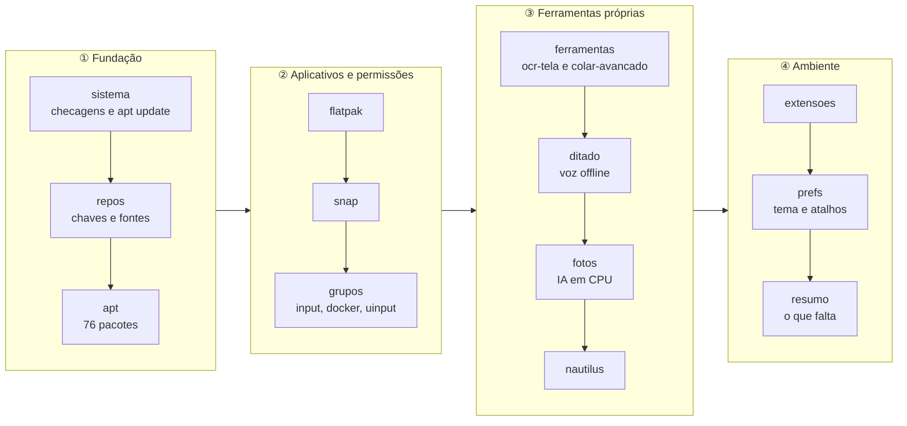

<div align="center">

# 🧰 nova-maquina

**Uma linha de comando entre o Ubuntu recém-instalado e a máquina de trabalho pronta.**

Treze etapas selecionáveis, modo de simulação e nenhum salto de fé: cada etapa
confere antes de agir, diz o que fez, e anota no fim o que ainda depende de você.

[](LICENSE)
[](#requisitos)
[](instalar.sh)
[](#o-que-a-simula%C3%A7%C3%A3o-mostra)

**Português** · [English](README.en.md)

`76 pacotes` · `18 Flatpaks` · `2 Snaps` · `3 extensões do GNOME` · `4 ferramentas próprias`

</div>

---

## O problema

Reinstalar o sistema é a parte fácil, e dura uma tarde. O que custa é a semana
seguinte: o atalho que você não lembra como criou, o pacote que só aparece
quando falta, a extensão que exigia um passo esquisito, a chave de repositório
que ninguém anota. A configuração de uma máquina de trabalho não mora em lugar
nenhum — mora na memória de quem a montou, e essa memória vence.

Este repositório é essa configuração escrita. Não foi redigida de memória: saiu
do inventário da máquina em uso — `apt-mark showmanual` cruzado com o que veio
na instalação base, mais Flatpak, Snap, extensões, serviços e `dconf`.

## Em trinta segundos

```bash
git clone https://github.com/augustotecnos/nova-maquina.git
cd nova-maquina
./instalar.sh --simular      # mostra tudo que faria, sem tocar em nada
./instalar.sh                # faz
```

Sem rede na máquina nova? Copie a pasta inteira por pendrive — o script não
precisa estar num repositório git. E é seguro rodar de novo: cada etapa confere
antes de agir.

## O caminho



## O que a simulação mostra

`--simular` imprime cada comando em vez de executá-lo. Saída real desta
máquina, com o caminho da pasta pessoal abreviado:

```console
$ ./instalar.sh --simular --so grupos,ditado

╺━ Grupos e permissões de entrada ━╸
  · já está no grupo input
  · já está no grupo docker
==> Regra do udev para o /dev/uinput
     $ sudo install -Dm644 ~/Projetos/nova-maquina/arquivos/udev/80-uinput.rules /etc/udev/rules.d/80-uinput.rules
     $ sudo udevadm control --reload-rules
==> Serviço do ydotool (digitação de reserva, sessão local)
     $ systemctl --user enable --now ydotool.service 2>/dev/null || true

╺━ Ditado por voz (Super+H) ━╸
  · ambiente Python já existe
==> instalando o daemon, o comando e o serviço
     $ install -Dm644 ~/…/arquivos/ditado/server.py ~/.local/share/ditado/server.py
     $ systemctl --user daemon-reload
```

Três sinais, sempre os mesmos: `==>` é o que vai ser feito, `·` é o que já
estava pronto, `$` é o comando exato — em execução de verdade, ele roda.

## Etapas

| # | Etapa | O que faz |
|---|---|---|
| 1 | `sistema` | confere Ubuntu/GNOME/Wayland e atualiza os índices do apt |
| 2 | `repos` | Chrome, Edge, VS Code, Docker, PPAs do Ulauncher e do Grub Customizer, Flathub, Tailscale |
| 3 | `apt` | os 76 pacotes, em sete grupos comentados |
| 4 | `flatpak` | 15 aplicativos do Flathub, mais 3 de jogos |
| 5 | `snap` | onlyoffice-desktopeditors, zotero-snap |
| 6 | `grupos` | grupos `input`, `docker`, `kvm`, `libvirt` e a regra do `uinput` |
| 7 | `ferramentas` | clona e instala o [ocr-tela](https://github.com/augustotecnos/ocr-tela) e o [colar-avancado](https://github.com/augustotecnos/colar-avancado), mais o CLI do `claude` |
| 8 | `ditado` | ditado por voz offline em `Super+H` (faster-whisper em CPU) |
| 9 | `fotos` | remover fundo com `rembg`; apagar objeto com IOPaint (opcional) |
| 10 | `nautilus` | "Copiar caminho", "Remover fundo" e "Apagar objeto" no menu do gerenciador de arquivos |
| 11 | `extensoes` | GSConnect, Draw on GNOME e GJS OSK |
| 12 | `prefs` | tema escuro, atalhos e a liberação do `Super+H` |
| 13 | `resumo` | a lista do que ainda depende de você |

```bash
./instalar.sh --so ditado,fotos     # só essas etapas
./instalar.sh --sem jogos,snap      # todas menos essas
./instalar.sh --listar              # o que existe
```

<details>
<summary><b>Ver os 76 pacotes do apt, por grupo</b></summary>

**Base** — linha de comando e utilitários de sistema (25)

`curl` · `wget` · `git` · `vim` · `nano` · `htop` · `ncdu` · `tmux` · `dos2unix` · `fastfetch` · `build-essential` · `make` · `cmake` · `openssh-server` · `openssh-client` · `synaptic` · `gdebi` · `baobab` · `gparted` · `timeshift` · `dconf-editor` · `gnome-tweaks` · `gnome-shell-extensions` · `flatpak` · `gnome-software-plugin-flatpak`

**Português do Brasil** — corretor, dicionários e ajuda traduzida (6)

`hunspell-pt-br` · `wbrazilian` · `wportuguese` · `gnome-user-docs-pt` · `libreoffice-l10n-pt-br` · `libreoffice-help-pt-br`

**Aplicativos** — o dia a dia (14)

`libreoffice` · `thunderbird` · `calibre` · `pdfarranger` · `gthumb` · `vlc` · `mpv` · `haruna` · `torbrowser-launcher` · `ulauncher` · `grub-customizer` · `google-chrome-stable` · `microsoft-edge-stable` · `code`

**Mídia** — imagem, vídeo e áudio (8)

`gimp` · `inkscape` · `krita` · `blender` · `kdenlive` · `audacity` · `obs-studio` · `ffmpeg`

**Desenvolvimento** — linguagens, banco e contêineres (17)

`python3-pip` · `python3-venv` · `python3-gi` · `python3-pil` · `nodejs` · `npm` · `golang-go` · `ruby` · `default-jre` · `openjdk-17-jdk` · `sqlite3` · `postgresql` · `postgresql-client` · `docker-ce` · `docker-ce-cli` · `containerd.io` · `docker-compose-plugin`

**Apoio às ferramentas próprias** — o que os instaladores dos projetos não cobrem (3)

`pulseaudio-utils` · `ydotool` · `python3-nautilus`

**Virtualização** — máquinas virtuais (3)

`qemu-system-x86` · `virt-manager` · `libvirt-daemon-system`

</details>

<details>
<summary><b>Ver os 18 aplicativos Flatpak e os 2 Snaps</b></summary>

**Flatpak** (15)

`com.brave.Browser` · `com.discordapp.Discord` · `com.github.dail8859.NotepadNext` · `com.github.vkohaupt.vokoscreenNG` · `com.spotify.Client` · `io.github.diegoivan.pdf_metadata_editor` · `io.github.giantpinkrobots.bootqt` · `me.fouquet.Stencil` · `nl.hjdskes.gcolor3` · `org.deskflow.deskflow` · `org.flatpak.Builder` · `org.gnome.design.Palette` · `org.kde.krename` · `org.localsend.localsend_app` · `org.telegram.desktop`

**Jogos** (3) — pule com `--sem-jogos`

`com.valvesoftware.Steam` · `net.lutris.Lutris` · `com.heroicgameslauncher.hgl`

**Snap** (2)

`onlyoffice-desktopeditors` · `zotero-snap`

</details>

## Opções

| Opção | Efeito |
|---|---|
| `-n`, `--simular` | imprime cada comando em vez de executar |
| `-l`, `--listar` | mostra as etapas |
| `--so a,b` / `--sem a,b` | escolhe ou pula etapas |
| `--sem-jogos` | não instala Steam, Lutris e Heroic |
| `--sem-opcionais` | não instala o Tailscale |
| `--com-iopaint` | instala o IOPaint (1,6 GB, Python 3.11 isolado) |
| `--com-experimentos` | instala o que está em `apt-experimentos.txt` |

A senha do `sudo` só é pedida se alguma etapa escolhida mexer no sistema —
`--so prefs`, por exemplo, roda sem pedir nada.

## Requisitos

| Item | Detalhe |
|---|---|
| Sistema | Ubuntu 26.04 (`resolute`); outras versões avisam e seguem |
| Área de trabalho | GNOME sobre Wayland — as ferramentas próprias supõem isso |
| Rede | necessária, exceto se você já trouxer a pasta pronta |
| Espaço | conte com 15–25 GB no total — os Flatpaks e os jogos são a maior fatia. Medidos aqui: ditado 905 MB, `rembg` 793 MB, IOPaint +1,6 GB |
| Privilégio | `sudo`, e só nas etapas que mexem no sistema |

## O que ele deliberadamente não instala

`listas/apt-experimentos.txt` guarda o que já foi testado nesta máquina e ficou
para trás, cada um com o motivo em comentário:

| Pacote | Por que ficou de fora |
|---|---|
| `onboard`, `maliit-*`, `matchbox-keyboard` | teclados virtuais da era X11; no Wayland sobem degradados. A extensão **GJS OSK** os substituiu |
| `flameshot` | não registra atalho global no Wayland |
| `esearch` | descartado em favor do `ocr-tela` |

Instale com `--com-experimentos` se quiser reavaliar.

## O que nenhum script resolve

1. **Sair e entrar na sessão.** Grupos novos e extensões do GNOME só valem em
   sessão nova — no Wayland não existe `Alt+F2` → `r`.
2. **Parear o celular no GSConnect** e, depois, ligar as duas chaves de
   clipboard, que vêm desligadas de fábrica (o comando está no `resumo`).
3. **Aceitar uma vez** o diálogo "Área de trabalho remota" no primeiro uso do
   Colar Avançado — é o que guarda a permissão do portal.
4. **Fazer login** no `claude`, no Tailscale e nas contas dos aplicativos.
5. O **modelo do Whisper** (~460 MB) baixa no primeiro ditado.

O `resumo` imprime essa lista no fim, junto com o que a execução anotou pelo
caminho.

## Manutenção

Quando esta máquina mudar, recapture o que dá para recapturar sozinho:

```bash
./atualizar-listas.sh
```

Ele substitui direto as listas de Flatpak e Snap e os arquivos que só existem
aqui (o daemon do ditado, as extensões do Nautilus, os scripts de foto), e gera
`listas/apt-detectado.txt` e `dconf/preferencias-atual.ini` para você comparar.
Essas duas exigem curadoria: a lista crua do apt vem com mais de cem pacotes de
base, e o dump do dconf vem com coisas específicas da máquina.

## Estrutura

```
instalar.sh                    o script — 550 linhas, treze etapas
atualizar-listas.sh            recaptura desta máquina
listas/                        pacotes, por grupo, com comentários
dconf/preferencias.ini         preferências e atalhos (@HOME@ é trocado na hora)
arquivos/ditado/               daemon, comando, serviço e dependências fixadas
arquivos/nautilus/             extensões em Python do gerenciador de arquivos
arquivos/fotos-ia/             worker do rembg e o lançador do IOPaint
arquivos/udev/                 regra que libera o /dev/uinput ao grupo input
arquivos/habilitar-extensao.py acrescenta um UUID à lista de extensões ativas
```

Cada execução fica registrada em `~/.cache/nova-maquina.log`.

## Três armadilhas que custaram teste

Estão comentadas no código, e valem para qualquer script parecido:

- **Etapa sob `| tee` roda em subshell.** As anotações do resumo iam para um
  array e evaporavam a cada etapa. Foram para um arquivo temporário.
- **Reconhecer repositório apt pela URL não funciona.** A mesma fonte aparece
  como `.list` ou `.sources`, escrita de outro jeito — o Chrome usa
  `chrome-stable` num e `chrome` no outro. E um `docker.list.disabled` contava
  como fonte ativa. A busca passou a usar um trecho identificador explícito,
  restrita a `--include='*.list' --include='*.sources'`.
- **`comm` exige ordenação em `LC_ALL=C`.** Com locale pt_BR ele reclama de
  "input is not in sorted order" e o script morre no meio.

## Isto é a configuração de uma máquina específica

Publicado como referência, não como produto: as listas são as **minhas**
escolhas de aplicativos, e os atalhos são os meus. Se for aproveitar, edite os
arquivos de `listas/` e o `dconf/preferencias.ini` antes de rodar — ou rode com
`--simular` primeiro e veja se concorda com tudo.

O que talvez valha para qualquer um, independentemente das listas: a estrutura
de etapas com simulação, a detecção de repositório apt descrita acima, e o
hábito de anotar no próprio script por que cada coisa está ali.

## Licença

MIT. Veja [LICENSE](LICENSE).
